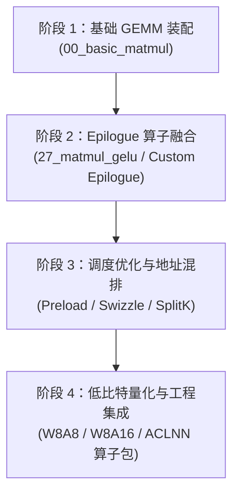
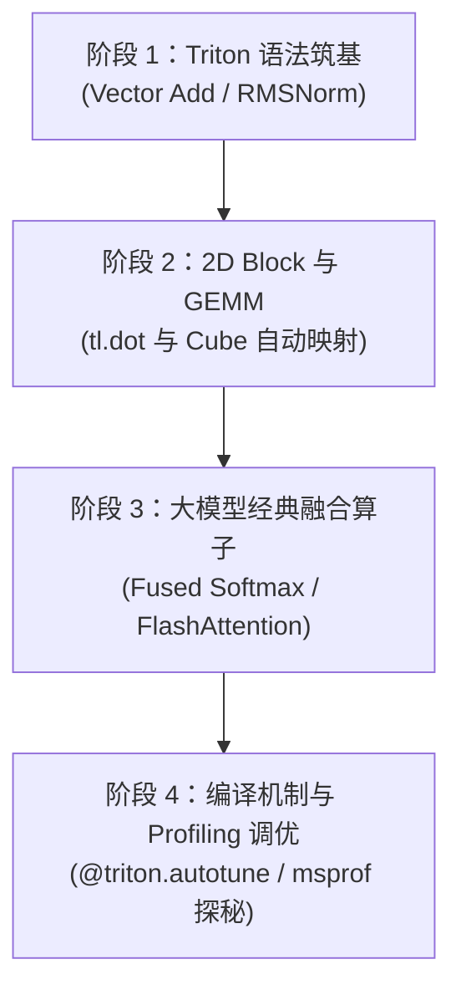

# 昇腾 CATLASS 与 Triton-Ascend 现代算子开发全景学习路线与实战指南

> **适用平台**：Atlas 200I DK A2 / Atlas 310B、Atlas A2 (910B) 以及下一代昇腾架构（Ascend 950）。  
> **前置知识**：已掌握基础 Ascend C 编程（了解 AI Core 的 Cube/Vector/MTE 硬件架构、片上内存 UB/L1/L0、流水线与同步概念）。  
> **核心目标**：从底层繁重的纯手写 C++ 流水同步中解放出来，掌握**现代 C++ 模板元编程（CATLASS）**与**高层 Python DSL 编译优化（Triton-Ascend）**两大核心开发范式。

---

## 0. 个人进度与计划调整（2026-10-20 更新，**本节优先于后文**）

### 0.1 真实起点盘点

| 维度 | 实际状态 | 对应本文档的阶段 |
| :-- | :-- | :-- |
| Ascend C 手写算子 | 已手写 matmul / matmul+leakyrelu / softmax / rmsnorm / **FA fwd+bwd** | 超过本文档假设的"前置知识" |
| CATLASS C++ | 环境已通（CANN 8.5.0 + 编译成功），未跑过（无 A2 卡）；模板装配在看 | 阶段 1 进行中 |
| **Triton 语言/算法** | **CS336 assignment2 写过 GPU 侧 FA（online softmax + tl.dot）** | **已达阶段 3** |
| **Triton-Ascend 平台** | **零**：venv 里是上游 `triton 3.7.0`（nvidia/amd 后端），**没有 triton-ascend**，一个 Ascend kernel 都没跑过 | **阶段 0** |

**结论：Triton 这条线对你是"错位"的** —— 不是从阶段 1（vector add / RMSNorm）开始学语法，而是
**跳过阶段 1、2，直接做「阶段 0.5 环境 + 阶段 3 迁移 + 阶段 4 调优」**。省下的约 1.5 周挪给 FA 双实现与调优。

### 0.2 调整后的双轨计划（等 910B 期间 + 上卡后）

| 周 | CATLASS 线（C++） | Triton-Ascend 线（Python） | 产出 |
| :-: | :-- | :-- | :-- |
| W1 | `catlass_lab/w1` 的 4 个受控实验 + 读 `kernel/basic_matmul.hpp` 骨架 | 装 triton-ascend（版本必须与 CANN 对齐），跑通 vector add | 实验记录 + 一个能跑的 Triton kernel |
| W2 | `matmul_leakyrelu`：host 装配 + 复用库 epilogue | 把 CS336 的 FA 前向改写成 Ascend 版（删 `num_warps`/`num_stages`、重设 BLOCK、去 `trans` 参数 / 去原子累加） | 两份"能编未跑"的算子 |
| W3 | 精读 `examples/23_flash_attention_infer`，出"我的 FA ↔ 23 号"对照表 | 逐条验证 Triton 的限制清单（能跑就跑，不能跑就列 diff 与理由） | 一份双实现对照表 |
| W4 | 写"我的 FA"精简版（砍 paged cache、固定 head_dim） | autotune / BLOCK 搜索方案 + profiling 计划（`msprof`） | 两个 FA 实现（C++ / Triton） |
| W5（上 910B） | 跑通 + `Compare success` + perf | 跑通 + 精度对齐 + perf | **C++ vs Triton 的 FA 对比报告**（给老师） |

> 这个"同一个 FA 用两种范式各写一遍"的结构，正好把原文档第四节 Week6 的"对比报告"提前到 W5 产出，
> 而且比"双轨各学一个 hello world"有说服力得多。

### 0.3 GPU Triton FA → Triton-Ascend：迁移检查清单

**能迁移的**：算法骨架（block 双层循环、online softmax 的 `m_i`/`l_i` 递推、causal mask、log-sum-exp 收尾、`tl.dot` 的累加语义）。
**不能照抄的**：启动配置与少数 API。逐条过：

| # | 检查项 | 为什么 | 动作 |
| :-: | :-- | :-- | :-- |
| 1 | `num_warps` / `num_stages` / `num_ctas` | GPU 独有参数，NPU 上**不生效** | 全部删除 |
| 2 | `grid=(...)` 的并行度来源 | Ascend 上 grid 由 program 数决定；核数要用 `driver.active.utils.get_device_properties(device)` 读 `num_vectorcore`/`num_aicore` | 别把核数当 kernel 启动参数传（会被 `KeyError` 拒） |
| 3 | `BLOCK_M/N/K` 尺寸 | 要按 UB 容量（A2 192KB）重算，GPU 的 `128×128` 不一定合适 | 从 64/128 起试，超 UB 会直接报 |
| 4 | `tl.dot` 的 `trans_a/trans_b` 等参数 | 部分 API 在 Ascend 上不支持 | 改成先 `tl.trans` 显式转置，或直接换 layout |
| 5 | 原子累加（bwd 里 dQ 的 `tl.atomic_add`） | 特定 atomic 操作支持受限 | 改确定性累加（split 到 workspace 再 reduce，和 CATLASS 的 SplitK 同思路） |
| 6 | 环境版本 | `triton-ascend` 会占用 `triton` 包名，与上游 3.7 冲突；且必须与 CANN 版本配对（本地资料示例：Triton-Ascend 3.2.1 ↔ CANN 9.0.0） | **单独 venv**，版本成套装，不要混 beta |

> 依据：本机 `~/.dsh/skills/triton-op-coding/SKILL.md:139-141`、`~/.cannbot/cann-bench/docs/guide/triton_ascend_quick_start.md:23-32`。
> 安装后先跑一个 vector add 确认 target 打印正常，再谈迁移 FA——否则你会把"环境问题"误判成"代码不兼容"。

### 0.4 与后文冲突时的效力

- CATLASS 四阶段（第二节）**仍然有效**，但具体路径以 `catlass_lab/README.md` 为准（那份是按你的目标与硬件重写的，且修正了本文档里 `BasicMatmul<ArchTag, ...>` 之类的写法错误）。
- Triton-Ascend 四阶段（第三节）**保留作知识索引**，但**阶段 1、2 你直接跳过**。
- 第四节"6 周双轨表"**作废**，以 0.2 为准。

---

## 一、 宏观全景对比：理解两大技术在昇腾生态的定位

在深入技术前，首先在脑海中建立业界与昇腾技术栈的完整映射地图：

```
【业界标准（NVIDIA 生态）】
CUDA C++ (底层编程) ──────> CUTLASS (C++模板元编程库) ──────> OpenAI Triton (Python DSL 编译器)

【华为昇腾（Ascend 生态）】
Ascend C (底层显式流水) ──> CATLASS (C++模板元编程库) ──────> Triton-Ascend (Python DSL 编译器)
```

### 1. 技术维度对比表

| 维度 | Ascend C (原生层) | CATLASS (现代模板层) | Triton-Ascend (高层编译层) |
| :--- | :--- | :--- | :--- |
| **编程语言** | C++ (类 TIK/CCE 风格) | **现代 C++ (模板元编程)** | **Python (DSL, `@triton.jit`)** |
| **抽象层级** | 物理核、队列、硬件 Event | **分层 Tile、DispatchPolicy、Epilogue** | **Block Pointer、多维 Tensor 表达式** |
| **片上内存管理** | 开发者手动切分 UB/L1/L0 | **通过模板参数自动计算与分配** | **MLIR 编译器后端自动分配与复用** |
| **流水线编排** | 手写 `SetFlag` / `WaitFlag` | **预置多种成熟的静态流水调度策略** | **编译器自动推导依赖并插入同步指令** |
| **学习曲线** | 陡峭（易死锁、易越界踩踏） | **中高（需扎实 C++ 模板与硬件认知）** | **平缓（几小时即可写出可用算子）** |
| **极限性能** | 理论上限最高，但极耗人时 | **逼近硬件物理极限（90%+ 算力利用率）** | **优秀（通过 autotune 快速逼近高性能）** |
| **最佳应用场景** | 定制奇特指令、极特殊硬件通路 | **标准 GEMM、量化矩阵乘 (W8A8)、卷积** | **多算子融合、RMSNorm、Softmax、FlashAttention** |

---

## 二、 CATLASS 深度剖析与学习路线

### 1. 核心设计哲学
CATLASS 是华为对标 NVIDIA CUTLASS 深度打造的 Ascend C 现代高性能模板库。它将原本混乱纠缠在一起的 Tiling 切分、数据搬运、矩阵乘与后处理计算彻底解耦为五个正交的抽象维度：

```
                   ┌────────────────────────────────────────┐
                   │               ArchTag                  │
                   │        (AtlasA2, Ascend950...)         │
                   └──────────────────┬─────────────────────┘
                                      ▼
                   ┌────────────────────────────────────────┐
                   │             DispatchPolicy             │
                   │  (Pingpong, Preload, SingleCoreSplitK) │
                   └──────────────────┬─────────────────────┘
                                      ▼
                   ┌────────────────────────────────────────┐
                   │               TileShape                │
                   │ (L1Tile: M×N×K, L0Tile: M×N×K, VecTile)│
                   └──────────┬──────────────────┬──────────┘
                              │                  │
                              ▼                  ▼
                  ┌──────────────────────┐  ┌───────────────────────┐
                  │      BlockMmad       │  │     BlockEpilogue     │
                  │ (Cube 矩阵计算核心块) │  │  (片上融合写出流水线)  │
                  └──────────┬───────────┘  └───────────┬───────────┘
                             └────────────┬─────────────┘
                                          ▼
                   ┌────────────────────────────────────────┐
                   │             Kernel 组装                │
                   │   BasicMatmul / MatmulActivation / ... │
                   └────────────────────────────────────────┘
```

#### 五大核心支柱：
1. **`ArchTag`（硬件架构标签）**：如 `catlass::arch::AtlasA2`，决定底层微架构指令集与硬件资源约束。
2. **`TileShape`（多级分块抽象）**：通过 `GemmShape<M, N, K>` 定义 L1 缓存级与 L0 寄存器级的切分粒度。
3. **`DispatchPolicy`（流水线调度策略）**：
   - `MmadAtlasA2Pingpong`：L1/L0 双缓冲流水（基线策略）。
   - `MmadAtlasA2Preload`：前置异步预加载（隐藏 MTE 访存延迟）。
   - `SingleCoreSplitk` / `MultiCoreSplitK`：K 轴切分优化大 K、小 M/N 场景。
4. **`BlockMmad`（矩阵乘计算核心）**：封装多核任务分发与硬件 Cube 驱动，结合 `BlockSwizzle` 打乱核间访存顺序以消除 HBM 带宽热点冲突。
5. **`BlockEpilogue`（后处理融合流水线）**：矩阵乘计算完成后，结果在写出阶段直接于片上进行 BiasAdd、激活函数（GELU/Swish）或量化/反量化，彻底消除额外的 GM 读写。

---

### 2. CATLASS 四阶段进阶学习路径



#### 阶段 1：基础 GEMM 装配（1 周）
- **核心任务**：读懂并跑通 `catlass/examples/00_basic_matmul`。
- **核心代码模式**：
  ```cpp
  #include "catlass/catlass.hpp"
  using namespace catlass;
  using namespace catlass::gemm;

  // 1. 选定架构与流水策略
  using ArchTag = arch::AtlasA2;
  using DispatchPolicy = MmadAtlasA2Pingpong;

  // 2. 规划多级分块
  using L1TileShape = GemmShape<128, 128, 64>;
  using L0TileShape = GemmShape<64, 64, 64>;

  // 3. 装配 Block 计算单元与输出 Epilogue
  using BlockMmad = BlockMmad<DispatchPolicy, L1TileShape, L0TileShape, ...>;
  using BlockEpilogue = epilogue::BlockEpilogueAtlasA2<...>;

  // 4. 组合为最终 Kernel
  using MatmulKernel = kernel::BasicMatmul<ArchTag, BlockMmad, BlockEpilogue>;
  ```
- **关键突破**：
  - 理解为何不需要手写 `DataCopy`，模板内部如何根据 `TileShape` 自动推导。
  - 调整 `L1TileShape` 的大小，观察编译期的 Buffer 静态断言（Static Assert）。

#### 阶段 2：Epilogue 算子融合（1 周）
- **核心任务**：研读 `catlass/examples/27_matmul_gelu`，掌握输出流水线挂接。
- **关键机制**：
  - 学习 `TileElemWise` 机制，理解 Cube 计算结果从 L0C 出来后，如何在片上直接流转给 Vector 进行非线性激活。
  - 编写自定义 Epilogue：实现 Matmul + BiasAdd + LeakyReLU 的多重融合。

#### 阶段 3：高级调度优化与 Swizzle（1 周）
- **核心任务**：研读 `06_optimized_matmul` 与 `09_splitk_matmul`。
- **深度剖析**：
  - **Preload 策略**：对比 `MmadAtlasA2Preload` 与 `MmadAtlasA2Pingpong`，用 Profiling 观察 MTE2 与 Cube 流水线的气泡消除。
  - **Swizzle（地址混排）**：理解 `GemmIdentityBlockSwizzle` 如何改变网格遍历顺序，避免多个核在同一时刻集中读取同一 DRAM/LPDDR bank。
  - **Split-K 场景**：在 LLM 解码阶段（Batch=1, SeqLen=1, 隐藏层大），单靠 M/N 无法填满核数时，利用 SplitK 沿 K 轴切分并利用原子加或二次规约写出。

#### 阶段 4：低比特量化与 ACLNN 工程化落地（1 周）
- **核心任务**：
  - 学习 `12_quant_matmul`（INT8 量化矩阵乘 + Per-Token 反量化）和 `30_w8a16_matmul`。
  - 参考 `catlass/examples/advanced/basic_matmul_aclnn`，掌握工业级交付范式：
    - `op_host`：参数解析、校验与动态 Tiling 策略生成。
    - `op_kernel`：Device 侧模板实例化与参数解包调用。
    - 最终暴露给 Python/C++ 调用的 `aclnn` 两段式执行流程。

---

## 三、 Triton-Ascend 深度剖析与学习路线

### 1. 核心设计哲学
Triton 原生以类似 Python 的高层语法，屏蔽了硬件底层线程编排的繁琐性。在昇腾 NPU 后端（Triton-Ascend）中：
- 开发者依然操作以 **Block（分块）** 为第一优先级的 Tensor 计算。
- **编译器底层机制**：Triton 编译器前端将代码转换为 Triton-IR (MLIR Dialect)，经过优化管道传递至昇腾专属 Dialect，自动将 2D 矩阵乘操作下沉映射到硬件 Cube，将一维矢量计算映射到 Vector，并由编译器**全自动推导和分配 UB/L1 空间，自动插入流水线同步指令（SetFlag/WaitFlag）**。

```
Python (@triton.jit)
       │ (tl.load, tl.dot, tl.store)
       ▼
   Triton IR (MLIR)
       │
       ▼
  Ascend Dialect (自动推导片上缓存分配、自动分析数据流依赖)
       │
       ▼
  CCE / Ascend C 机器码 (驱动 Cube/Vector/MTE 异步流水线)
```

---

### 2. Triton-Ascend 四阶段进阶学习路径



#### 阶段 1：Triton 语法筑基与 Vector 算子（3~5 天）
- **核心概念**：
  - `tl.program_id(axis)`：获取当前分配的工作核 ID。
  - `tl.arange(0, BLOCK_SIZE)`：构造分块内的相对逻辑偏移。
  - `tl.load(ptr, mask)` 与 `tl.store(ptr, val, mask)`：带安全掩码（Mask）的片上读写。
- **动手实操**：
  1. **Vector Add**：实现你的第一个 Triton-Ascend 算子，验证 NPU 端到端执行。
  2. **RMSNorm / LayerNorm**：在单个 Block 内完成求和归约（`tl.sum`）与反向方差计算，体验无需手写 `ReduceSum` 临时 Buffer 的便捷性。

#### 阶段 2：2D Block 指针与 GEMM 核心算子（1 周）
- **核心目标**：理解 `tl.dot` 如何被昇腾编译器自动识别并映射到 DaVinci Cube。
- **核心代码模式**：
  ```python
  import triton
  import triton.language as tl

  @triton.jit
  def matmul_kernel(
      a_ptr, b_ptr, c_ptr,
      M, N, K,
      stride_am, stride_ak, stride_bk, stride_bn, stride_cm, stride_cn,
      BLOCK_SIZE_M: tl.constexpr, BLOCK_SIZE_N: tl.constexpr, BLOCK_SIZE_K: tl.constexpr,
  ):
      # 获取二维 Grid 索引
      pid_m = tl.program_id(0)
      pid_n = tl.program_id(1)

      offs_m = (pid_m * BLOCK_SIZE_M + tl.arange(0, BLOCK_SIZE_M)) % M
      offs_n = (pid_n * BLOCK_SIZE_N + tl.arange(0, BLOCK_SIZE_N)) % N
      offs_k = tl.arange(0, BLOCK_SIZE_K)

      # 累加器初始化 (FP32 精度保底)
      accumulator = tl.zeros((BLOCK_SIZE_M, BLOCK_SIZE_N), dtype=tl.float32)

      # 沿 K 轴循环遍历
      for k in range(0, tl.cdiv(K, BLOCK_SIZE_K)):
          a = tl.load(a_ptr + offs_m[:, None] * stride_am + offs_k[None, :] * stride_ak)
          b = tl.load(b_ptr + offs_k[:, None] * stride_bk + offs_n[None, :] * stride_bn)
          accumulator += tl.dot(a, b)  # 自动映射为昇腾 Cube 矩阵乘
          offs_k += BLOCK_SIZE_K

      c = accumulator.to(tl.float16)
      tl.store(c_ptr + offs_m[:, None] * stride_cm + offs_n[None, :] * stride_cn, c)
  ```
- **关键认知**：
  - `tl.dot` 内部自动走 Cube，无需手动处理 $16 \times 16$ 分形排布（Fractal/NZ 格式），编译器会自动处理加载转换。

#### 阶段 3：大模型核心融合算子实战（1 周）
- **实战 1：Fused Softmax**：
  - 编写带 Online 最大值减去的 Softmax 算子，理解如何在单次访存内融合 Max、Exp、Sum 与 Div。
- **实战 2：SwiGLU 激活前向融合**：
  - 将门控线性单元（Gate GEMM + Up GEMM + SiLU 激活 + 元素乘）在单个 Kernel 内组合完成。
- **实战 3：FlashAttention-2**：
  - 研读 Triton 官方实现的 FlashAttention 源码，理解双层 Tile 循环（外层遍历 $Q$，内层遍历 $K, V$）和在线动态 Softmax 状态更新。

#### 阶段 4：编译底层机制与 Profiling 调优（1 周）
- **性能自动搜索**：
  - 使用 `@triton.autotune` 配置不同的 `BLOCK_SIZE_M`、`BLOCK_SIZE_N`、`BLOCK_SIZE_K`，让系统自动在 NPU 上寻找最优超参组合。
- **底层探秘与调试**：
  - 通过 `msprof` 分析 Triton 生成算子的硬件占用率、流水线气泡及片上内存命中情况。
  - 查看 Triton 生成的 MLIR 中间表达（TTIR），了解它如何将高阶语句降低为硬件事件。

---

## 四、 推荐的 6 周双轨并行学习路线表

建议采用**“双轨并行、对照印证”**的学习节奏，同一算子分别用 CATLASS 和 Triton 实现，形成闭环对比：

| 周次 | CATLASS 研发线 (C++ / 深度与极限) | Triton-Ascend 研发线 (Python / 广度与敏捷) | 产出与里程碑 |
| :---: | :--- | :--- | :--- |
| **Week 1** | 跑通 `00_basic_matmul`，理解 `ArchTag`、`TileShape` 与模板装配 | 搭建环境，跑通 Vector Add 与 RMSNorm 算子 | 掌握两套开发环境与 HelloWorld |
| **Week 2** | 深入 `TileShape` 调优，观察编译期 Buffer 约束 | 实现 2D Block 经典 GEMM，理解 `tl.dot` 底层行为 | 矩阵乘法双面镜（对比代码行数与性能） |
| **Week 3** | 研读 `27_matmul_gelu`，掌握 Epilogue 访客机制与融合 | 实现 Fused Softmax 与 Fused SwiGLU / MLP | 算子融合实战（体验片上写出流水） |
| **Week 4** | 研读 `06_optimized_matmul`，掌握 Preload 与 Swizzle | 跑通并研读 Triton 版 FlashAttention 前向实现 | 复杂流水线与长序列大模型算子突破 |
| **Week 5** | 学习 `12_quant_matmul`，掌握 W8A8 量化与反量化流水 | 使用 `@triton.autotune` 进行网格搜索与超参寻优 | 性能极致优化与低比特量化支持 |
| **Week 6** | 学习 `advanced/basic_matmul_aclnn` 工业级交付流程 | 使用 `msprof` 对两套实现进行端到端硬件瓶颈对比剖析 | 交付一份完整的实验对比报告向导师汇报 |

---

## 五、 实用避坑指南与高手经验

### 1. 片上内存（UB/L1）红线意识
- **在 CATLASS 中**：编译器在静态期通过 `sizeof` 强校验你的 Buffer 分配。如果分块设置过大超出硬件上限，编译阶段直接报错拦截。
- **在 Triton-Ascend 中**：虽然编译器替你管内存，但如果你把 `BLOCK_SIZE_M=256, BLOCK_SIZE_N=256` 设得过大，后端在分配 UB 或 L1 时会直接抛出 **Out of Unified Buffer / Out of Memory** 错误。牢记 Atlas 200I 只有 192KB UB，Atlas A2 只有 256KB UB。

### 2. 硬件物理对齐约束
- 昇腾硬件天生要求 **32 字节对齐**（FP16 下为 16 个元素，Cube 计算单元也是 $16 \times 16 \times 16$）。
- 无论在 CATLASS 选型还是 Triton 设置分块大小，所有 Tile 维度的长度都**务必保持 16/32 的整倍数**，否则会触发低效的 Padding 甚至硬件错误。

### 3. 技术选型决策树（向导师汇报与开题时使用）

```
                         你的算子开发目标是什么？
                                    │
           ┌────────────────────────┴────────────────────────┐
           ▼                                                 ▼
【计算密集型标准化大算子】                         【算法迭代频繁 / 多算子强融合】
(标准 GEMM / 量化 W8A8 / GroupMatmul)             (RMSNorm / Fused Softmax / MoE / FA)
           │                                                 │
           ▼                                                 ▼
   使用 【CATLASS】                                   使用 【Triton-Ascend】
• 追求 90%+ 算力极限利用率                         • 原型验证周期以“天”甚至“小时”计
• 严格匹配硬件微架构与静态内存布局                 • 依赖编译器自动流水生成与内存分配
• 作为底层基础设施算子库沉淀                       • 与 PyTorch / vLLM / SGLang 高层生态紧密贴合
```
