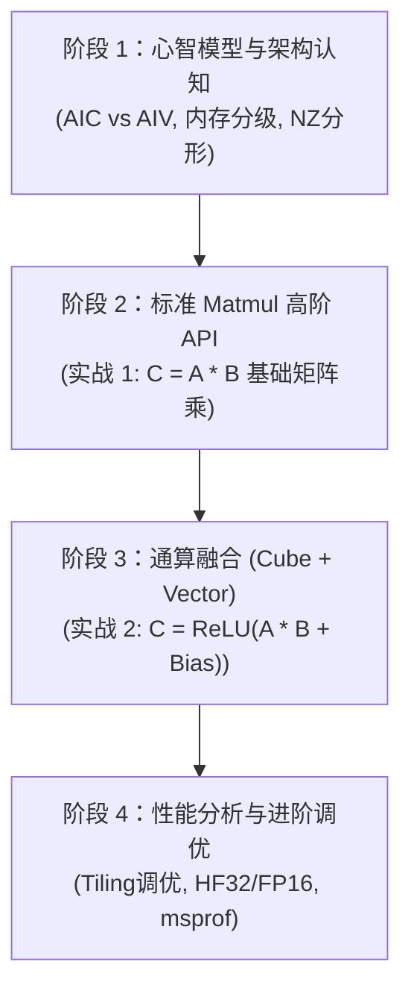

# 昇腾 Ascend C Cube 算子开发系统学习路线图与实战指南

> **适用平台**：Atlas 200I DK A2 / Atlas 500 A2 (Ascend 310B / DAV_3002, 1 AI Core / 2 Vector Core) 以及昇腾全系列 AI 处理器。  
> **前置知识**：已掌握 Ascend C Vector 算子开发（TPipe/TQue 内存管理、核间切分、双缓冲流水、PyTorch C++ 扩展接入）。

---

## 一、 认知升级：Vector vs Cube 算子心智模型

从一维矢量计算（Vector）迈向二维矩阵乘（Cube / GEMM），核心转变在于硬件计算单元、内存层次结构以及数据格式。

```
【Vector 模式（一维流水）】
Global Memory (GM) <──DataCopy──> Unified Buffer (UB) <──Vector 指令──> 计算结果

【Cube 模式（二维脉动阵列）】
Global Memory (GM) 
    │ (A 矩阵)                  │ (B 矩阵)
    ▼                           ▼
  L1 Buffer (A1)              L1 Buffer (B1)
    │                           │
    ▼                           ▼
  L0A Buffer (A2)             L0B Buffer (B2)
    └───────────┬───────────────┘
                ▼
       Cube Unit (16×16×16 MACs)
                │
                ▼
          L0C Buffer (CO1, 累加器)
                │
        ┌───────┴───────┐
        ▼ (直接写回)     ▼ (通算融合)
    Fixpipe ──> GM    Unified Buffer (UB) ──> Vector 指令 (ReLU/BiasAdd) ──> GM
```

### 核心对比维度

| 维度 | Vector 算子 | Cube 算子 |
| :--- | :--- | :--- |
| **计算核心** | AIV（Vector Core），1D SIMD 矢量计算 | **AIC（Cube Core）**，16×16×16 脉动阵列（GEMM） |
| **数据流转** | GM $\leftrightarrow$ UB（单层片上缓存） | **GM $\to$ L1 $\to$ L0A/B $\to$ Cube $\to$ L0C $\to$ GM / UB**（多级流水） |
| **编程范式** | 手动管理 `TQue`、`AllocTensor`、`EnQue/DeQue` | **官方推荐：`AscendC::Matmul` 高阶 API**（自动调度 L1/L0 流水） |
| **数据排布** | 线性 ND 格式（连续一维行向量） | 原生是 **NZ / Fractal（分形 16×16）** 格式；高阶 API 支持 ND 输入自动适配 |
| **Tiling 维度** | 1D（行数 / 元素总数多核切分） | **3D（$M, N, K$ 空间三维切分）**：单核切分 + L1 切分 + L0 基础块 |

---

## 二、 四阶段系统学习路线图



### 阶段 1：硬件架构与数据流心智模型（理论打底，1~2 天）
- **学习目标**：深入理解 Cube 硬件流水线与内存分级。
- **关键知识点**：
  1. **AIC 与 AIV 架构分工**：在 Atlas 200I DK A2 上，Cube 专职完成矩阵乘累加（$C = A \times B + C$）。纯 Cube 计算在 AIC 执行，AIV 需添加守卫退出。
  2. **多级存储架构**：
     - **L1 Buffer (A1/B1)**：片上缓存，暂存从 GM 搬入的矩阵块。
     - **L0A / L0B Buffer**：将矩阵重排并喂入脉动阵列的操作数缓存。
     - **L0C Buffer (CO1)**：乘加累加器，保存中间累加结果。
     - **Fixpipe 单元**：负责将 L0C 中的结果格式转换并搬出到 GM 或 UB。
  3. **数据格式（ND vs NZ）**：普通行优先矩阵（ND）与昇腾硬件原生 16×16 分形矩阵（Fractal NZ）。
- **验收标准**：能够清晰画出 GM $\to$ L1 $\to$ L0A/B $\to$ Cube $\to$ L0C $\to$ GM 的完整数据流。

---

### 阶段 2：核心生产力——Ascend C Matmul 高阶 API（基础 GEMM，3~4 天）
- **学习目标**：掌握昇腾工业界标准的 `AscendC::Matmul`（`MatmulImpl`）高阶 API 开发与 Host 端 Tiling。
- **关键知识点**：
  1. **Kernel 端四步法**：
     - **类型声明**：通过 `MatmulType<TPosition::GM, CubeFormat::ND, half, false>` 定义矩阵属性。
     - **配置定义**：使用 `MM_CFG_NO_PRELOAD`（关键参数 `enUnitFlag=true`，确保 Fixpipe 写回 GM）。
     - **初始化**：`mm.Init(&tiling, pipe)`，`mm.SetSingleShape(M, N, K)`，`mm.SetTensorA(...)`，`mm.SetTensorB(...)`。
     - **一键遍历写回**：`mm.IterateAll(cGm, 0)` 自动遍历所有 baseBlock 并在完成计算后写回 GM。
  2. **Host 端 Tiling 计算**：
     - 调用 CANN 官方 `MatmulApiTiling` 库（`matmul_tiling::MatmulApiTiling`）。
     - 配置矩阵维度 $M, N, K$、数据类型、是否带 Bias，自动生成 `TCubeTiling` 结构体。
  3. **AIC 入口守卫**：
     - 在 Kernel 的 `Init` 与 `Process` 首行加入 `if (ASCEND_IS_AIV) { return; }`。
- **实战项目 1**：创建 `matmul_npu` 工程，完成基础稠密矩阵乘 $C = A \times B$（FP16/FP32），并用 PyTorch 扩展调用与 `torch.matmul` 对齐精度。

---

### 阶段 3：通算融合——Cube + Vector 融合算子（进阶核心，4~5 天）
- **学习目标**：打通 Cube 与 Vector 的协同流水，实现大模型常见的 Linear + 激活层融合。
- **关键知识点**：
  1. **分块获取结果到 UB**：
     - 不使用 `IterateAll` 直接写 GM，改用 `mm.Iterate()` + `mm.GetTensorC(ubTensor)` 将 Cube 累加结果拉入 Unified Buffer (UB)。
  2. **UB 上的 Vector 融合计算**：
     - 矩阵乘单块进 UB 后，无缝调用熟悉的 Vector API（如 `Adds` 做偏置相加、`Relu` / `Gelu` 激活、`Cast` 转换精度）。
  3. **数据搬出**：
     - 通过 `DataCopy` 将 UB 中融合计算后的最终结果刷回 GM。
- **实战项目 2**：编写一个 **Linear + Bias + ReLU** 融合算子：$C = \text{ReLU}(A \times B + \text{Bias})$，验证融合算子相对单独调用的性能收益。

---

### 阶段 4：进阶调优与性能分析（高阶工程师进阶）
- **学习目标**：掌握极致性能调优抓手与分析工具。
- **关键知识点**：
  1. **Tiling 核心参数微调**：
     - `baseM / baseN / baseK`（L0 计算颗粒度，通常为 16 的倍数，如 64×64×64）。
     - `depthA1 / depthB1`（L1 双缓冲 Double Buffer，掩盖数据搬运耗时）。
  2. **精度模式控制**：
     - FP32 运算中的 `HF32` 模式（`mm.SetHF32(true, 1)`），在损失极微小尾数精度的情况下获得约 4 倍吞吐。
  3. **Profiling 工具分析**：
     - 使用 `msprof` 分析 Cube 计算利用率（诊断是 MTE 搬运瓶颈还是 Cube 算力瓶颈）。

---

## 三、 关键避坑指南（老手踩坑经验）

开发 Cube 算子时，以下几个高频陷阱需要重点防范：

1. **`TilingHeader` 必须通过标量直接拷贝到栈上**：
   Tiling 数据是从 GM 传过来的标量结构体。**严禁**用 `DataCopy` 拷进 UB 后做指针强转给 `mm.Init()`，这会在 AIC 触发 MPU 越界异常（Error 507015）。必须用 4 字节整数循环标量读到 Stack 局部变量上！
   ```cpp
   template <typename HeaderT>
   __aicore__ inline void LoadTilingFromGM(GM_ADDR tilingGM, HeaderT &dstStack) {
       constexpr uint32_t HEADER_INTS = (sizeof(HeaderT) + sizeof(int32_t) - 1U) / sizeof(int32_t);
       const auto *gmInts  = reinterpret_cast<const __gm__ int32_t *>(tilingGM);
       auto       *dstInts = reinterpret_cast<int32_t *>(&dstStack);
       for (uint32_t i = 0; i < HEADER_INTS; ++i) {
           dstInts[i] = gmInts[i];
       }
   }
   ```

2. **`MatmulConfig` 的 `enUnitFlag` 必须为 true**：
   如果配置使用了默认值且 `enUnitFlag=false`，Fixpipe 硬件不会把 L0C 的累加结果写回到 GM，导致输出**全部为 0**！请使用预置的 `MM_CFG_NO_PRELOAD`。

3. **Host 侧 `SetMadType` 与 Kernel 侧 `SetHF32` 必须完全配对**：
   - Host: `MatrixMadType::NORMAL` $\leftrightarrow$ Kernel: `SetHF32(false, 0)`（强制全 FP32）
   - Host: `MatrixMadType::HF32` $\leftrightarrow$ Kernel: `SetHF32(true, 1)`（使能 HF32 加速）
   两端不配对会导致内部缓冲区计算错位，甚至核崩溃。

4. **转置标志 `isTrans` 必须一致**：
   `MatmulType<..., isTrans>` 模板参数中的转置声明必须与调用 `SetTensorA(..., isTrans)` 时的布尔值严格相同。

---

## 四、 核心代码最小骨架速查

```cpp
#include "kernel_operator.h"
#include "lib/matmul_intf.h"

using namespace AscendC;
using namespace matmul;

template <typename T, typename BiasT = float>
class MatmulKernelImpl {
public:
    using A_TYPE    = MatmulType<TPosition::GM, CubeFormat::ND, T,     false>;
    using B_TYPE    = MatmulType<TPosition::GM, CubeFormat::ND, T,     false>;
    using C_TYPE    = MatmulType<TPosition::GM, CubeFormat::ND, T>;
    using BIAS_TYPE = MatmulType<TPosition::GM, CubeFormat::ND, BiasT>;

    __aicore__ inline void Init(GM_ADDR aGM, GM_ADDR bGM, GM_ADDR biasGM,
                                GM_ADDR cGM, GM_ADDR tilingGM, TPipe* pipe) {
        if (ASCEND_IS_AIV) { return; } // AIC 守卫
        LoadTilingFromGM<TilingHeader>(tilingGM, header_);

        aGm_.SetGlobalBuffer((__gm__ T*)aGM, header_.cubeTiling.M * header_.cubeTiling.Ka);
        bGm_.SetGlobalBuffer((__gm__ T*)bGM, header_.cubeTiling.Kb * header_.cubeTiling.N);
        cGm_.SetGlobalBuffer((__gm__ T*)cGM, header_.cubeTiling.M * header_.cubeTiling.N);

        mm_.SetSubBlockIdx(0);
        mm_.Init(&header_.cubeTiling, pipe);
        mm_.SetHF32(false, 0); // 与 Host 端的 MatrixMadType::NORMAL 配对
    }

    __aicore__ inline void Process() {
        if (ASCEND_IS_AIV) { return; } // AIC 守卫
        const int32_t blockIdx = GetBlockIdx();
        if (blockIdx >= header_.totalBlock) return;

        // 设置当前分块尺寸并执行计算
        mm_.SetSingleShape(header_.cubeTiling.singleCoreM, 
                           header_.cubeTiling.singleCoreN, 
                           header_.cubeTiling.singleCoreK);
        mm_.SetTensorA(aGm_[offsetA], false);
        mm_.SetTensorB(bGm_[offsetB], false);
        mm_.IterateAll(cGm_[offsetC], 0);

        PipeBarrier<PIPE_AIC>(); // 等待 Cube 完成
    }

    __aicore__ inline void End() { 
        if (ASCEND_IS_AIV) { return; }
        mm_.End(); 
    }

private:
    TilingHeader header_{}; // 栈变量
    MatmulImpl<A_TYPE, B_TYPE, C_TYPE, BIAS_TYPE, MM_CFG_NO_PRELOAD> mm_;
    GlobalTensor<T> aGm_, bGm_, cGm_;
};
```

---

## 五、 配套参考资源与源码索引

1. **CANN 本地头文件（最权威的实现参考）**：
   - 接口定义：`/usr/local/Ascend/ascend-toolkit/latest/include/highlevel_api/lib/matmul/matmul_intf.h`
   - 实现源码：`/usr/local/Ascend/ascend-toolkit/latest/include/highlevel_api/lib/matmul/matmul_impl.h`
   - Host 侧 Tiling 头文件：`/usr/local/Ascend/ascend-toolkit/latest/include/tiling/matmul/matmul_tiling.h`

2. **本地环境内置精编指南**：
   - [Matmul 高阶 API 最佳实践与反模式](file:///home/notixa/.gemini/config/skills/ascendc-api-best-practices/references/api-matmul.md)
   - [Matmul 三级 Tiling 策略与多核切分原理](file:///home/notixa/.gemini/config/skills/ascendc-tiling-design/references/matmul/ascendc-api-matmul-tiling.md)

3. **官方样例代码库**：
   - Gitee 开源仓 `ascend/samples` 中检索 `tutorials/03_matmul_custom`。

---

## 六、 附录：板端同步排除说明

为了保持板端（Atlas 200I DK A2）系统存储整洁、避免非可执行的 Markdown 文档污染板端构建环境，同步脚本中已默认添加如下排除规则：

- `remote_run.fish` 中已配置：
  ```fish
  --exclude '*.md'
  ```
- 手动使用 `rsync` 时推荐参数：
  ```bash
  rsync -avz --exclude 'build' --exclude '.venv' --exclude '*.so' --exclude '*.a' --exclude '*.md' \
      ./ atlas:/home/HwHiAiUser/projects/ascendc/
  ```
